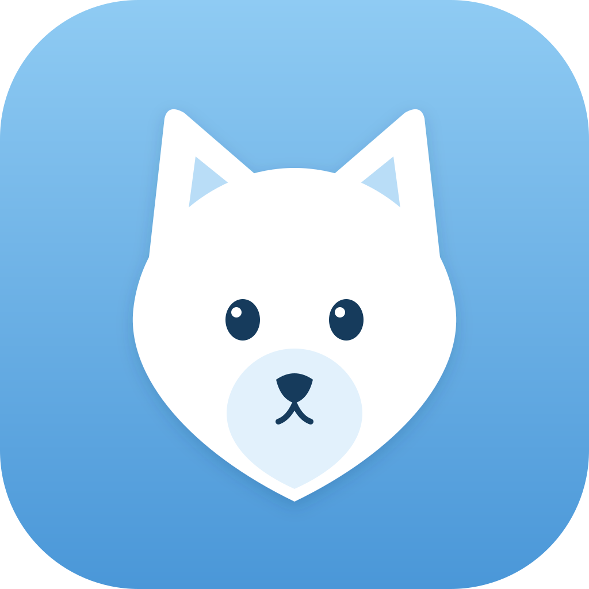

<p align="center">
  
</p>

<h1 align="center">Frost</h1>

<p align="center">
  <a href="https://github.com/alex-pimentel/frost/blob/main/LICENSE"></a>
  
  <a href="https://github.com/alex-pimentel/frost/stargazers"></a>
</p>

<p align="center">
  Desktop AI agent platform — voice, multi-agent orchestration, RAG, and coding.<br/>
  Built on <a href="https://github.com/OpenWhispr/openwhispr">OpenWhispr</a> and <a href="https://github.com/can1357/oh-my-pi">oh-my-pi</a>.
</p>

---

Frost is a desktop AI agent combining voice dictation with AI-powered agent orchestration. Fork of Frost with the oh-my-pi coding agent engine embedded.

**Chat mode**: Talk or type — input routes through a Think Agent (any model via omp's 40+ providers) with optional tool calling via Cactus (Needle 26M), then responds via TTS.

**Dictation mode**: Original Frost behavior — press a hotkey, speak, text appears at cursor.

## Features

- **Voice I/O** — whisper.cpp / sherpa-onnx STT, Piper/Kokoro TTS, floating icon, global hotkeys
- **Chat mode** — conversational AI with RAG, tools, and skills
- **Agent Orchestrator** — Think Agent → Cactus (tool calls) → TTS pipeline
- **Multi-agent dispatch** (v2) — parallel sub-agents for complex tasks
- **Loop control** (v2) — detects and blocks repetitive tool calls
- **RAG engine** (v2) — ingest text, PDFs, images → vector search via sqlite-vec
- **Mode switching** — toggle between dictation and chat from system tray

## Quick start

```bash
git clone https://github.com/alex-pimentel/frost.git
cd frost
npm install
npm run dev
```

Requires Node.js 22+. See [AGENTS.md](AGENTS.md) for detailed project context and architecture.

## Architecture

```
Voice (STT/TTS) → Orchestrator → Think Agent → Cactus (tool calls) → omp tools → TTS
```

- **Orchestrator** routes voice/text through a Think Agent (any model)
- **Cactus** (Needle 26M, 14MB) handles structured tool calling via ONNX runtime
- **Multi-Agent Dispatcher** (v2) fans out parallel sub-agents
- **Loop Detector** (v2) prevents infinite tool call loops via dedup + thresholds
- **RAG Engine** (v2) indexes sessions and documents via sqlite-vec + local embeddings

## Tech stack

Electron 41, React 19, TypeScript, Tailwind CSS v4, better-sqlite3, whisper.cpp, sherpa-onnx, ONNX runtime, `@oh-my-pi/pi-coding-agent`, shadcn/ui

## License

[MIT](LICENSE) — free for personal and commercial use.

## Acknowledgments

- **[OpenWhispr](https://github.com/OpenWhispr/openwhispr)** — voice dictation foundation
- **[oh-my-pi](https://github.com/can1357/oh-my-pi)** — coding agent engine
- **[Pi](https://github.com/badlogic/pi-mono)** — original agent harness by Mario Zechner
